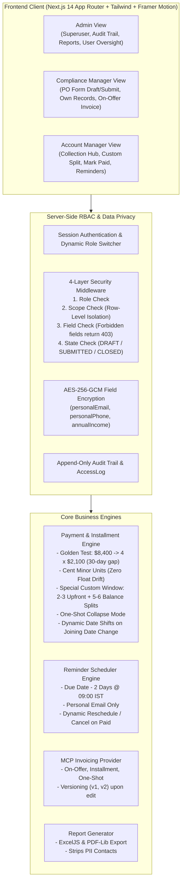

# System Architecture — Candidate Compliance & Payments Dashboard

## 1. System Overview
The Candidate Compliance & Payments Dashboard is an internal post-placement collection CRM. It connects candidate onboarding with accounts receivable, ensuring Background Checks (BGC), placement terms, installment schedules, automated reminders, and invoices are governed under strict role-based access.

---

## 2. Role Boundaries & Data Isolation

### Exactly 3 Roles
1. **Admin**:
   - Complete system oversight.
   - Can view and edit all candidates across `DRAFT`, `SUBMITTED`, and `CLOSED` states.
   - Access to Master Audit Trail, User Management, and Monthly PDF/Excel Reports.
   - Exclusive authority to "Unmark Paid" on an installment (requires mandatory remark).
2. **Compliance Manager (CM)**:
   - Scoped strictly to own created candidates (`createdBy = me`). Other CMs' records return 404.
   - Creates and edits PO Detail Form (Draft saving allowed anytime; Submit validates 10 mandatory fields).
   - Read-only access to payment schedules; can edit due date and amount with a mandatory remark.
   - Cannot mark installments paid, toggle one-shot, or view reminders/reports/audit trail.
3. **Account Manager (AM)**:
   - Scoped to `SUBMITTED` and `CLOSED` records only (`DRAFT` records return 404).
   - Sensitive fields (**Marketing Email/Phone, Recruiter, Manager, Package, Annual Income**) are stripped from the API payload.
   - Manages collections: "Mark Paid" (records date, cancels reminder, closes record if balance is $0).
   - Customizes payment schedules via the **Special Payment Window** (2-3 on-offer + 5-6 remaining installments).
   - Triggers installment invoices via MCP.

---

## 3. Custom Payment Flexibility Window
To accommodate real-world candidate needs beyond flat 4-installment splits:
- **On-Offer / Upfront Split (2–3 parts)**:
  - Splits the upfront amount into 2 or 3 installments around the candidate's joining date.
- **Remaining Balance Split (5–6 parts)**:
  - Splits $(\text{Total Payable} - \text{Upfront Amount})$ into 5 or 6 monthly cycles (30 days apart).
- **Mandatory Remark Rule**:
  - Any custom schedule adjustment requires an explicit, audited reason (minimum 5 characters).

